  

  

    
    
    
    
  

##  About Me

> 금융 IT 기업 **OASYS**에서 개발자로 일하고 있습니다. 사내 GPU 서버에서 LLM을 파인튜닝하고 에이전트 기반 문서 검색을 연구하며, 은행에 공급하는 자체 금융 솔루션을 만듭니다. 실험으로 성능을 증명하고, 그 결과를 실제로 운영되는 제품으로 완성하는 것이 제 일하는 방식입니다.

-  **LLM Engineering** — 온프레미스 GPU 서버에서 LLM 파인튜닝과 평가
-  **Agentic Retrieval** — 에이전트 기반 문서 검색 연구
-  **FinTech Product** — 은행에 공급하는 금융 솔루션 개발

과정은 꾸준하게, 결과는 확실하게.

 

##  Now Building

**[gonlith](https://github.com/gonida1010/gonlith)** — 어떤 AI를 쓰든 같은 기억과 지식을 쓰게 해 주는 로컬 기억·지식 저장소 (MCP · 오픈소스 · 개발 중)

 

##  Competitions

  <table>
    <tr>
      <th>대회</th>
      <th>최종 순위</th>
      <th>규모</th>
      <th>Private Score</th>
    </tr>
    <tr>
      <td><a href="https://github.com/gonida1010/SKKU-Multimodal-Challenge-2026"><b>2026 성균관대학교 멀티모달 AI Bias 챌린지</b></a> DACON · VLM 사회적 편향 · 개인</td>
      <td> <b>1위</b> 시상은 참가 자격(대학·대학원 재학) 요건으로 대상 외</td>
      <td>263팀 · 561명</td>
      <td>BA 0.94821</td>
    </tr>
    <tr>
      <td><a href="https://github.com/gonida1010/Kaggle_Predicting_Stellar_Class"><b>Kaggle Playground S6E6 · Predicting Stellar Class</b></a> Kaggle · 정형 데이터 분류 · 개인</td>
      <td> <b>27위</b> · 상위 1%</td>
      <td>2,816팀</td>
      <td>0.97029</td>
    </tr>
    <tr>
      <td><a href="https://github.com/gonida1010/dacon-structural-stability"><b>구조물 안정성 물리 추론 AI 경진대회</b></a> DACON · Physics/Vision AI · 5인 팀</td>
      <td> <b>16위</b> · 상위 4%</td>
      <td>484팀</td>
      <td>LogLoss 0.01903</td>
    </tr>
  </table>

 

##  Projects

### AgentShield · LLM 보안 검증 플랫폼 `팀장`

> **Red(공격) → Judge(판정) → Blue(방어)** 멀티 에이전트 파이프라인으로 LLM 챗봇의 취약점을 자동 진단·완화하는 보안 검증 플랫폼

- **Red Agent** — 라운드 기반 적응형 공격 프롬프트 생성 (다국어 / 인코딩 회전 / 도메인 컨텍스트)
- **Judge (LangGraph)** — Evidence Scanner · Strict Auditor · Context Auditor 합의로 vulnerable / safe / ambiguous 판정
- **Blue Agent** — 방어 규칙 생성 → 검증 → **Guardrail Policy Package** 산출
- **OWASP LLM Top 10 커버** — Prompt Injection · Sensitive Info · Excessive Agency · System Prompt Leakage

<a href="https://github.com/gonida1010/AgentShield" target="_blank"> GitHub</a> · <a href="https://www.notion.so/AgentShield-3646e129440d80c1929ed7548d313d2e?source=copy_link" target="_blank"> Notion</a>

---

### Meat-A-Eye · 축산물 부위 인식 & 원스톱 정보 플랫폼 `팀장`

> 사진 한 장으로 축산물 부위를 인식하고 시세·영양·이력·레시피까지 한 번에 제공하는 AI 마이크로서비스

- **부위 인식** — EfficientNet-B2 파인튜닝으로 소·돼지 부위 9·7종 분류 (정확도 94.2%)
- **하이브리드 OCR** — EasyOCR + PaddleOCR 결과 병합으로 이력번호 인식 (88.9%)
- **운영 인프라** — AWS EC2 + Docker Compose + Nginx 기반 마이크로서비스

<a href="https://github.com/gonida1010/Meat-A-Eye-Service" target="_blank"> GitHub</a> · <a href="https://www.notion.so/Meat-A-Eye-2e26e129440d8035ad3ef7c7df562ceb?source=copy_link" target="_blank"> Notion</a>

 

##  Tech Stack

<table>
  <tr>
    <td valign="top" width="50%">

 **AI / LLM**
LLM Fine-Tuning(LoRA) · Agent · RAG · Vision · OCR · RL

     

  </td>
  <td valign="top" width="50%">

 **Backend / Infra**
Model Serving · Async API · RDBMS · Vector DB · Container

     

  </td>
  </tr>
</table>

 

##  Daily Grind

  <picture>
    <source media="(prefers-color-scheme: dark)" srcset="https://raw.githubusercontent.com/gonida1010/gonida1010/output/bomberman-contribution-graph-dark.svg" />
    <source media="(prefers-color-scheme: light)" srcset="https://raw.githubusercontent.com/gonida1010/gonida1010/output/bomberman-contribution-graph.svg" />
    
  </picture>

 

  

  

